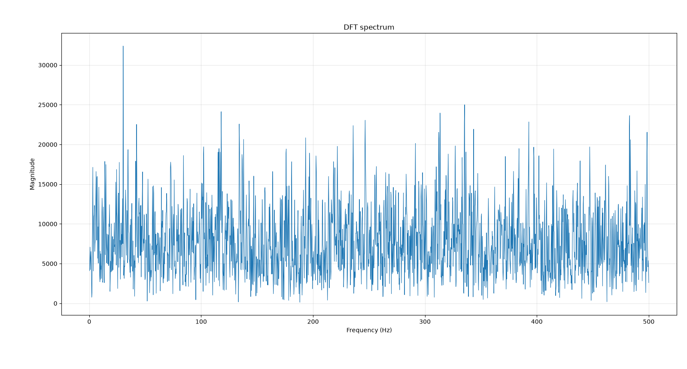

# Pulsar Signal Dispersion & Dedispersion Simulation

A C project simulating the dispersion of a pulsar's radio emission as it travels through the interstellar medium and is observed by a multi-channel radio telescope.

The project implements:

- A multi-channel pulsar signal generator with interstellar dispersion and noise.
- A dedispersion algorithm to recover the original pulse profile.
- A Fast Fourier Transform (radix-2, iterative) to estimate the pulsar's rotation period.
- Python visualisation tools to inspect the generated signal, the dedispersed profile and its frequency spectrum.
- A study of how the background noise level affects the detection of the pulsar's fundamental frequency.

## 1. Physical background

A pulsar emits short, periodic radio pulses over a wide range of frequencies simultaneously (broadband emission).

As the signal travels through the ionised interstellar medium, lower frequencies are delayed more than higher frequencies. This phenomenon is called **dispersion**.

The time delay relative to a reference frequency is:

$$
\Delta t(f) = K_{\mathrm{DM}}\ \mathrm{DM}\left(\frac{1}{f^2}-\frac{1}{f_{\mathrm{ref}}^2}\right)
$$

where:

- $K_{\mathrm{DM}} = 4148.8\ \mathrm{MHz^2\ pc^{-1}\ cm^3\ s}$
- $\mathrm{DM}$ is the dispersion measure, in $\mathrm{pc\ cm^{-3}}$
- $f$ and $f_{\mathrm{ref}}$ are frequencies in MHz.

A radio telescope observes the frequency band through several channels. Without correction, the pulse appears progressively delayed at lower frequencies.

**Dedispersion** consists of shifting each channel back by its expected delay and summing the channels. This restores the original pulse profile.

The maximum delay across the observed frequency band is:

$$
\Delta t_{\max} = K_{\mathrm{DM}}\ \mathrm{DM}\left(\frac{1}{f_{\min}^2}-\frac{1}{f_{\max}^2}\right)
$$

For the default parameters, this delay is approximately 59 ms.

### Pulse model

Each pulse is a Gaussian of standard deviation $\sigma$ (`PULSE_SIGMA`, in samples), emitted every `PERIOD_INDEX` samples:

$$
s(t) = \exp\left(-\frac{1}{2}\left(\frac{t-t_0}{\sigma}\right)^{2}\right)
$$

For speed, each pulse is only evaluated within $\pm 6\sigma$ of its centre, where the Gaussian is already negligible compared to the noise.

## 2. Project structure

```
pulsars/
│
├── config.h
│
├── generate.c
├── dedispersion.c
├── dft.c                  (FFT implementation)
│
├── plot/
│   ├── plot_generated.py
│   ├── plot_dedispersed.py
│   └── plot_magnitudes.py
│
├── result/
│   ├── dft_spectrum_NOISE_AMPLITUDE_70.png
│   └── dft_spectrum_NOISE_AMPLITUDE_100.png
│
├── signal.csv
├── dedispersed.csv
├── magnitudes.csv
│
└── README.md
```

### C programs

| File             | Description                                                                          |
| ---------------- | ------------------------------------------------------------------------------------ |
| `generate.c`     | Generates the dispersed multi-channel pulsar signal and writes `signal.csv`.         |
| `dedispersion.c` | Applies dedispersion and writes the recovered signal to `dedispersed.csv`.           |
| `dft.c`          | Computes the spectrum of the dedispersed signal with an FFT and writes `magnitudes.csv`. |
| `config.h`       | Defines the physical and numerical parameters shared by all C programs.              |

> The file is still called `dft.c` for historical reasons: it first contained a direct $O(N^2)$ DFT, which was replaced by an $O(N\log N)$ FFT.

### Python visualisation scripts

| Script                     | Description                                                                |
| -------------------------- | -------------------------------------------------------------------------- |
| `plot/plot_generated.py`   | Displays the generated multi-channel signal as a 2D time-frequency image.  |
| `plot/plot_dedispersed.py` | Displays the recovered dedispersed pulse profile as a function of time.    |
| `plot/plot_magnitudes.py`  | Displays the Fourier magnitude spectrum and saves the figure in `result/`. |

## 3. Physical and numerical parameters

All simulation parameters are defined in `config.h`.

| Parameter         | Description                                                        | Value                           |
| ----------------- | ------------------------------------------------------------------ | ------------------------------- |
| `DT`              | Time resolution per sample (s)                                     | $10^{-3}$                       |
| `N`               | Number of time samples per channel                                 | see `config.h`                  |
| `N_CHANNEL`       | Number of frequency channels                                       | 64                              |
| `F_MIN`           | Lowest observed frequency (MHz)                                    | 1200                            |
| `F_MAX`           | Highest observed frequency (MHz)                                   | 1500                            |
| `F_REF`           | Reference frequency (MHz)                                          | `F_MAX`                         |
| `DM`              | Dispersion measure ($\mathrm{pc\ cm^{-3}}$)                        | 56.8                            |
| `K_DM`            | Dispersion constant                                                | 4148.8                          |
| `FIRST_PULSE_POS` | Reference-channel pulse position (sample index)                    | see `config.h`                  |
| `PULSE_SIGMA`     | Standard deviation of the Gaussian pulse (samples)                 | see `config.h`                  |
| `PERIOD`          | Pulsar rotation period (s)                                         | 0.033                           |
| `PERIOD_INDEX`    | Rotation period in samples                                         | Computed (33)                   |
| `NOISE_AMPLITUDE` | Peak-to-peak amplitude of the uniform background noise             | see `config.h` (70 and 100 studied below) |
| `SEED`            | Seed of the random number generator                                | see `config.h`                  |
| `MAX_DELAY`       | Maximum dispersion delay (samples)                                 | Computed (59)                   |
| `N_UTIL`          | Number of usable samples after dedispersion (**power of two**)     | Computed                        |

The default dispersion measure corresponds approximately to that of the Crab pulsar (B0531+21).

### Constraint on `N_UTIL`

The radix-2 FFT requires the number of samples to be a power of two. This is checked at compile time in `dft.c`:

```c
_Static_assert(N_UTIL >= 2 && (N_UTIL & (N_UTIL - 1)) == 0,
               "N_UTIL must be a power of 2");
```

Since $N_{\mathrm{UTIL}} = N - \mathrm{MAX\_DELAY}$, `N` must be chosen accordingly. If you change `DM`, `F_MIN` or `F_MAX`, `MAX_DELAY` changes and `N` must be adjusted, otherwise `dft.c` will not compile.

### Time resolution and observation duration

The time resolution must be sufficiently small to resolve the pulse width.

The total observation duration is:

$$
T_{\mathrm{obs}} = N \times \mathrm{DT}
$$

This is considerably longer than the maximum dispersion delay of approximately 59 ms.

After dedispersion, the usable observation duration and the frequency resolution of the spectrum are:

$$
T_{\mathrm{util}} = N_{\mathrm{UTIL}} \times \mathrm{DT}
\qquad
\Delta f = \frac{1}{N_{\mathrm{UTIL}}\ \mathrm{DT}}
$$

For $N_{\mathrm{UTIL}} = 4096$ and $\mathrm{DT} = 1\ \mathrm{ms}$, this gives $\Delta f \approx 0.244\ \mathrm{Hz}$. The Nyquist frequency is $1/(2\ \mathrm{DT}) = 500\ \mathrm{Hz}$.

## 4. Compilation

The project requires a C compiler supporting the C17 standard (`_Static_assert`, `<complex.h>`) and the mathematical library.

For example, using GCC:

```
gcc -Wall -Wextra -Werror -std=c17 -g \
    -fsanitize=address,undefined \
    -o generate generate.c -lm

gcc -Wall -Wextra -Werror -std=c17 -g \
    -fsanitize=address,undefined \
    -o dedispersion dedispersion.c -lm

gcc -Wall -Wextra -Werror -std=c17 -g \
    -fsanitize=address,undefined \
    -o dft dft.c -lm
```

The `-lm` option links the mathematical library and must appear after the source file.

All three programs include `config.h`.

**Important:** if a parameter is modified in `config.h`, all three programs must be recompiled to ensure that they use consistent values.

## 5. Execution

Run all commands from the project root directory.

The programs must be executed in the following order because each step uses the output of the previous one.

### Step 1: Generate the dispersed signal

```
./generate
```

This program:

- Seeds the random number generator with `SEED`.
- Generates a periodic train of Gaussian pulses, including pulses emitted before the start of the observation.
- Applies a frequency-dependent delay to each channel according to the dispersion law.
- Adds independent uniform background noise in $[-\mathrm{NOISE\_AMPLITUDE}/2,\ +\mathrm{NOISE\_AMPLITUDE}/2]$ to every sample.
- Writes the resulting dynamic spectrum to `signal.csv`.

### Step 2: Dedisperse the signal

```
./dedispersion
```

This program:

- Reads `signal.csv`.
- Recomputes the channel delays using the physical parameters.
- Shifts each channel back to its expected arrival time.
- Sums the channels to recover the pulse profile.
- Writes the result to `dedispersed.csv`.

The delays are recomputed directly from `DM`, `K_DM` and the channel frequencies, with the same rounding as in `generate.c`. No intermediate delay file is required.

### Step 3: Compute the Fourier spectrum

```
./dft
```

This program:

- Reads `dedispersed.csv` (and warns if fewer than `N_UTIL` samples are found).
- Applies a Hann window and subtracts the Hann-weighted mean of the signal.
- Computes the spectrum with an in-place iterative radix-2 FFT (precomputed twiddle factors, bit-reversal permutation, then butterflies).
- Keeps the first $N_{\mathrm{UTIL}}/2+1$ bins, which are the only independent ones for a real signal.
- Writes the frequency spectrum to `magnitudes.csv`.

### Step 4: Visualise the results

Install the Python dependencies:

```
python -m pip install numpy pandas matplotlib
```

Run the visualisation scripts from the project root:

```
python plot/plot_generated.py
python plot/plot_dedispersed.py
python plot/plot_magnitudes.py
```

The scripts use the CSV files generated by the C programs. The Fourier spectrum figure is saved in `result/`.

## 6. Edge effects, spectral leakage and FFT

### Edge effects

During dedispersion, each channel is shifted by its corresponding delay.

For a time sample $t$, the algorithm reads the original channel at index:

$$
t + \mathrm{delay}
$$

Consequently, the last samples of the original observation do not contain valid contributions from every channel.

To avoid an artificial decrease in amplitude at the end of the dedispersed profile, the output is truncated to:

$$
N_{\mathrm{UTIL}} = N - \mathrm{MAX\_DELAY}
$$

Only samples for which all channels contain valid data are retained. The FFT therefore works on exactly `N_UTIL` samples, which also fixes the frequency axis.

### Spectral leakage

The observation does not contain an integer number of pulsar rotations, so a rectangular observation window would spread energy into neighbouring frequency bins (spectral leakage).

To reduce this effect, a Hann window is applied:

$$
w[n] = \frac{1}{2}\left(1-\cos\left(\frac{2\pi n}{N_{\mathrm{UTIL}}-1}\right)\right)
$$

The signal is windowed after subtracting its **Hann-weighted mean**:

$$
\bar{x}_w = \frac{\sum_n x[n]\ w[n]}{\sum_n w[n]}
\qquad
x'[n] = \left(x[n]-\bar{x}_w\right)w[n]
$$

With this choice, $\sum_n x'[n] = 0$ by construction, so the 0 Hz bin of the spectrum is zero up to rounding errors. Subtracting the plain (unweighted) mean would leave a residual component at 0 Hz.

The Hann window reduces leakage but broadens the main spectral peak and lowers its amplitude.

### FFT

The direct DFT costs $O(N^2)$ operations; the radix-2 FFT costs $O(N\log_2 N)$. For $N_{\mathrm{UTIL}} = 4096$ this is roughly $N/\log_2 N \approx 340$ times fewer operations.

## 7. Output files

### `signal.csv`

Contains the generated multi-channel signal in long format, with one row per channel and time sample.

```
channel,i,amplitude
0,0,0.000000
0,1,0.000012
...
```

### `dedispersed.csv`

Contains the dedispersed signal, with one row per usable time sample (`N_UTIL` rows).

```
i,amplitude
0,0.019300
1,0.039726
...
```

### `magnitudes.csv`

Contains the Fourier magnitude spectrum $|X[k]|$ for $k = 0,\dots,N_{\mathrm{UTIL}}/2$, in arbitrary units (the FFT is not normalised and the Hann window scales the amplitudes).

```
freq,magnitudes
0.000000,...
0.244141,...
...
```

The frequency values are expressed in Hz.

## 8. Results and influence of the noise level

### Expected results at low noise

- **Dispersed signal:** the pulses appear progressively delayed at lower frequencies, producing a characteristic dispersion sweep.
- **Dedispersed signal:** the individual channel contributions add coherently, producing a much sharper pulse profile whose amplitude can reach about `N_CHANNEL` (64), since each channel contributes a pulse of amplitude 1.
- **Fourier spectrum:** the fundamental frequency appears at $1/P \approx 30.3\ \mathrm{Hz}$ (period of 33 ms), together with harmonics at about 60, 90, 120 and 150 Hz.

### Noise model

In each channel, the noise is uniform with peak-to-peak amplitude $A = \mathrm{NOISE\_AMPLITUDE}$, so its standard deviation is $A/\sqrt{12}$. Dedispersion sums `N_CHANNEL` independent channels, so the noise of the dedispersed profile has standard deviation:

$$
\sigma_{\mathrm{sum}} = A\sqrt{\frac{N_{\mathrm{CHANNEL}}}{12}} \approx 2.31\ A
$$

while the dedispersed pulse peaks at about 64. The noise is therefore far smaller than the pulse for $A = 0.1$, but much larger than it for $A = 70$ or $100$ — the pulsar is invisible in the time domain and can only be recovered by the Fourier analysis, which integrates over $N_{\mathrm{UTIL}}$ samples.

For a white noise filtered by the Hann window, the noise magnitude of each spectral bin follows a Rayleigh distribution of scale:

$$
\sigma_R = \sigma_{\mathrm{sum}}\sqrt{\frac{\sum_n w[n]^2}{2}}
= \sigma_{\mathrm{sum}}\sqrt{\frac{3\ N_{\mathrm{UTIL}}}{16}}
$$

and the largest noise peak expected among $N_{\mathrm{bins}} = N_{\mathrm{UTIL}}/2+1$ bins is about:

$$
\sigma_R\sqrt{2\ln N_{\mathrm{bins}}}
$$

For $N_{\mathrm{UTIL}} = 4096$:

| `NOISE_AMPLITUDE` | $\sigma_{\mathrm{sum}}$ | $\sigma_R$ (spectrum) | Expected highest noise peak |
| ----------------- | ----------------------- | --------------------- | --------------------------- |
| 70                | ≈ 162                   | ≈ $4.5\times10^{3}$   | ≈ $1.75\times10^{4}$        |
| 100               | ≈ 231                   | ≈ $6.4\times10^{3}$   | ≈ $2.5\times10^{4}$         |

The signal peak does not depend on the noise level, so increasing `NOISE_AMPLITUDE` lowers the significance of the detection until the fundamental peak is no longer distinguishable from the highest noise peaks.

### `NOISE_AMPLITUDE = 70` (log scale)


- The fundamental peak at about 30.3 Hz is clearly visible, at about $3\times10^{4}$, i.e. roughly $6.7\ \sigma_R$ above the noise scale.
- The median noise level is about $5\times10^{3}$ and the highest noise peaks reach about $1.7\times10^{4}$, in agreement with the Rayleigh prediction above. The deep dips towards $10^{2}$ are normal for Rayleigh-distributed magnitudes and are exaggerated by the logarithmic scale.
- The harmonics are buried in the noise.

### `NOISE_AMPLITUDE = 100` (linear scale)



With a higher noise level, the expected highest noise peaks rise to about $2.5\times10^{4}$, close to the height of the fundamental peak, so the detection becomes marginal.

<!-- TODO: describe what is actually visible on the figure above (is the 30 Hz peak still the highest bin?). -->

## 9. Current implementation status

- [x] Gaussian pulse generation (width `PULSE_SIGMA`, evaluated within $\pm 6\sigma$).
- [x] Multi-channel signal generation.
- [x] Frequency-dependent dispersion following the $1/f^2$ law.
- [x] Pulses emitted before the observation window, to avoid empty regions at the edge of the dynamic spectrum.
- [x] Uniform background noise with a configurable amplitude and seed (`NOISE_AMPLITUDE`, `SEED`).
- [x] CSV export.
- [x] Signal visualisation.
- [x] Dedispersion by shifting and summing frequency channels.
- [x] Automatic computation of `MAX_DELAY` and `N_UTIL`, with a compile-time power-of-two check.
- [x] Hann windowing with Hann-weighted mean subtraction (no residual 0 Hz component).
- [x] Radix-2 iterative FFT, replacing the direct $O(N^2)$ DFT.
- [x] Fourier spectrum visualisation and noise-level study (`NOISE_AMPLITUDE` = 70 and 100).

## 10. Future improvements

- [ ] **Dispersion measure search:** dedisperse the signal over a range of trial DM values and plot the signal-to-noise ratio as a function of DM. The maximum should occur near the true DM.
- [ ] **Detection significance:** compute the signal-to-noise ratio of the fundamental peak from the data (peak height relative to the median or $\sigma_R$ of the surrounding bins) instead of relying on the analytical estimate above.
- [ ] **Noise scan:** plot this signal-to-noise ratio as a function of `NOISE_AMPLITUDE` to find the detection limit.
- [ ] **Harmonic summing / folding:** add the power at the harmonics of the candidate frequency, or fold the profile at the detected period, to recover signal lost in the noise.
- [ ] **Gaussian noise:** replace the uniform noise by Gaussian noise, closer to real radiometer noise.
- [ ] **Real pulsar data:** apply the dedispersion algorithm to public filterbank data from an observed pulsar.

## 11. References

- [ATNF Pulsar Catalogue](https://www.atnf.csiro.au/research/pulsar/psrcat/) — pulsar parameters, including dispersion measures.
- Crab pulsar (B0531+21) — reference dispersion measure of approximately $56.8\ \mathrm{pc\ cm^{-3}}$.

---

**Project objective:** simulate the propagation of a pulsar radio signal through the interstellar medium, recover its original pulse profile using dedispersion, and estimate its rotation period through Fourier analysis, including in the presence of strong noise.
